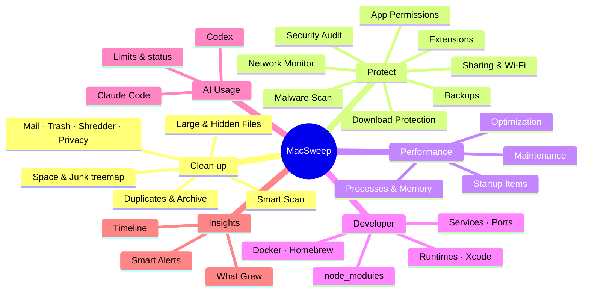
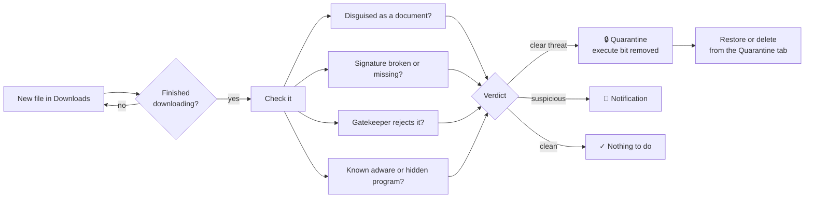
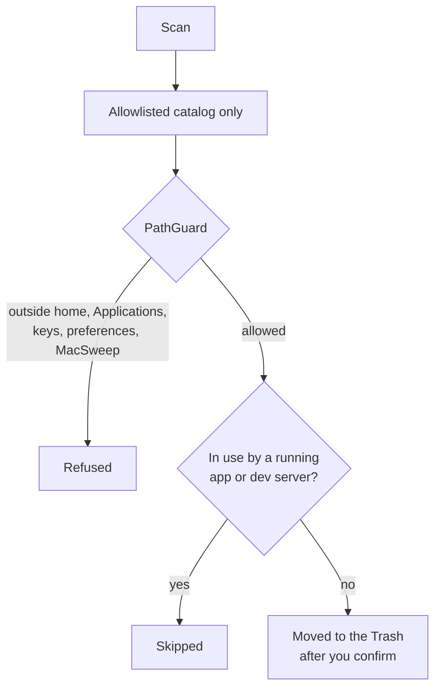
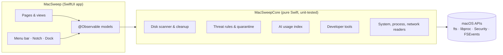

<div align="center">

# MacSweep

**One native app to clean, speed up, protect and understand your Mac.**

SwiftUI · macOS 15+ · Apple Silicon · no third-party dependencies · everything stays on your Mac

[**Explore the website**](https://shipiit.github.io/mac-sweep-website/) · [**⬇ Download the latest .dmg**](https://github.com/shipiit/mac-sweep/releases/latest)

    

</div>

---

## At a glance



## What it does

### 🧹 Clean up
| | |
|---|---|
| **Smart Scan** | One button checks junk, security, speed and apps in about 20 seconds, then cleans up step by step in an "Optimizing your Mac" view with a Stop ring. |
| **Space & Junk** | A treemap of every folder, hidden ones included, with a folder panel to tick items anywhere. Recommendations are split into *Safe to remove* and *Review first*; growth badges show what grew since the last scan, and a forecast says when the disk would fill at the current rate. Finds app update leftovers, old CLI and editor-extension versions, unfinished runtime downloads, AI model caches and more. |
| **Cleanup script & tool commands** | Generates a script that uses each tool's own clean command (`npm cache clean`, `pnpm store prune`, `brew cleanup`…) and can run them for you with a live log. Review-first items never run. |
| **Weekly auto-clean** | Opt-in: moves safe junk (never anything in use) to the Trash once a week and tells you how much. |
| **Large & Hidden Files** | The biggest files, grouped by kind (AI sessions & models, developer files, app data, media, installers, macOS assets) with Safe / Think first / Keep labels, what deleting each causes, and a review sheet before anything moves to the Trash. |
| **Browser Profiles** | Size of every Chrome, Brave, Edge, Arc and Vivaldi profile; clean caches per profile (never logins, cookies or bookmarks). |
| **Duplicates & Archive** | Byte-for-byte duplicates (SHA-256; one copy is always kept), similar photos via on-device Vision, and old projects zipped to an external drive or iCloud, verified before the original can go. |
| **Mail, Trash, Shredder, Privacy** | Mail attachment copies, every Trash bin, secure delete, and browser history, cookies and caches (passwords and bookmarks are never touched). |

### 🛡 Protect
| | |
|---|---|
| **Malware Scan** | Quick, Full and **Deep** scans (whole home folder, apps, startup folders). Finds disguised programs (`invoice.pdf.app`), broken or missing code signatures, Gatekeeper rejections, known adware and hidden executables, and shows Apple XProtect's definition version. Keeps a history of every scan. |
| **Download Protection** | Checks every finished download and keeps the last 20 with where they came from, who signed them and the verdict. Clear threats are moved to quarantine before you can open them; suspicious files raise a notification. On by default. |
| **Quarantine** | Quarantined files have their execute permission removed. Restore or delete them any time. |
| **Security Audit** | A protection score with SIP, Gatekeeper, FileVault, Firewall and XProtect status (the Firewall can be turned on from here), suspicious startup items, high-risk extensions, recommendations and app-permission counts. The sidebar badge shows **Secure** or the number of issues. |
| **App Permissions** | Which apps can use the camera, microphone, screen recording, Full Disk Access or Accessibility, flagged by risk, with a jump to revoke. |
| **Network Monitor** | Live connections per app with the hosts they talk to; untrusted programs going online are flagged. |
| **Sharing & Wi-Fi · Backups · Extensions** | Wi-Fi security, SSH and screen sharing, firewall and AirDrop; Time Machine age and excluded folders; browser extensions per profile with their permissions. |

### ⚡ Performance
| | |
|---|---|
| **Processes & Memory** | Activity-Monitor-accurate memory and CPU, a leak flag for steadily growing apps, idle apps with optional auto-quit. |
| **Optimization & Maintenance** | A ranked advisor with one-click fixes; flush DNS, rebuild Launch Services, reindex Spotlight and more. |
| **Memory Guard** | When memory stays under pressure, tells you which idle apps use the most or quits them politely (like ⌘Q, at most three, never the app you're using). Shows what's using your memory and what keeps growing. |
| **Startup Items & Startup Guard** | Login items, launch agents and daemons with stop, disable and enable. The opt-in guard holds anything new until you approve it. |

### 🛠 Developer
| | |
|---|---|
| **Developer hub** | Docker storage and prune, Homebrew outdated packages and cleanup, Node/Python/Ruby versions, Xcode DerivedData and simulators, every `node_modules` in your home folder, and dev services (Postgres, Redis…) with start, stop and logs. |
| **Git Repos** | Repositories with the biggest `.git` folders; filter, sort, and compact safely (`git gc`, reflogs kept) or prune the LFS cache. Repos in use are skipped. |
| **Ports** | Every listening port with the project folder and command that started it; open, copy or stop it. |

### 📦 Applications
Uninstaller with leftovers, Updater, App Usage, and **App Footprint**: each app's real size including caches, support data and containers, with *Clear cache* or *Reset app* (refused while the app runs; Apple apps are never touched).

### 🤖 AI Usage
Claude Code and Codex tokens and API-equivalent cost by model, project and session. It shows live 5-hour and weekly limits and the service status of both tools, and updates within seconds of each message. Real Claude plan limits are an **opt-in**, read-only setting.

### 📈 Insights
**Smart Alerts** notify you about low disk, memory leaks, runaway CPU, overheating, new login items and a big Trash. A **14-day Timeline** shows CPU, memory, disk and network, with spikes explained. **What Grew** compares two disk scans.

### 🖥 Always there
A two-line menu bar item, a notch HUD that expands on hover (System, Apps, Ports, AI, Clean, with charts), and a live Dock icon. A short sidebar (main pages, one row per area whose pages open as tabs, a storage card), pages hideable in Settings → Sidebar, and an Appearance pane with a live preview of theme, accent and background. Results are kept between visits, so you scan once and rescan only when you want fresh numbers.

---

## How protection works



MacSweep works alongside Apple's built-in XProtect; it is a heuristic checker, not a signature antivirus. macOS reserves true real-time blocking for apps with Apple's Endpoint Security entitlement, so files are quarantined the moment they finish downloading.

## How cleanup stays safe



- **Allowlist only:** nothing outside the cleanup catalog is ever suggested.
- **PathGuard** refuses anything outside your home folder, `/Applications` and `/Users/Shared`, plus keys (`.ssh`, `.aws`, Keychains), system preferences and MacSweep itself.
- **Trash by default:** permanent deletion is always opt-in and confirmed. Duplicate removal always keeps one copy; archives are verified before the original can go.
- **Private:** no analytics. The only network calls are ones you trigger, plus the public Claude and OpenAI status pages.

## Lightweight by design

- Live process sampling runs every 3 s only while a page that shows it is open; otherwise every 10 s.
- AI usage reads only new transcript lines and wakes on file changes instead of polling.
- Big scans release memory as they go: a Deep Scan of 4.5 million files peaks around 220 MB and memory is handed back afterwards.
- Typical idle use: about 100 MB of memory and 1–3% CPU with the window open.

## Architecture



All logic lives in `MacSweepCore` with 600+ tests; the app target is thin views and models.

## Install

1. Download **MacSweep.dmg** from [Releases](https://github.com/shipiit/mac-sweep/releases/latest) and drag MacSweep to Applications.
2. The build is ad-hoc signed (not notarised), so the first time **right-click → Open**, or run:
   ```sh
   xattr -dr com.apple.quarantine /Applications/MacSweep.app
   ```
3. For full results, grant **Full Disk Access** in System Settings → Privacy & Security.

## Build from source

```sh
make test      # 600+ unit tests
make app       # build/MacSweep.app (ad-hoc signed)
make dmg       # build/MacSweep.dmg
make install   # build, quit the running copy, install to /Applications and relaunch
bash scripts/make-signing-cert.sh   # optional, once: a local signing identity so macOS keeps
                                    # Full Disk Access and Keychain approvals across your own builds
```

Requires Xcode 16 / Swift 6 toolchain on macOS 15 or later.

## Product website

The animated, five-page showcase lives in [`website/`](website/README.md). Preview it with:

```sh
python3 -m http.server 4173 --directory website/dist --bind 127.0.0.1
```

Open http://127.0.0.1:4173. The site includes a detailed capability guide, sample-data UI demonstrations, developer and AI tools, privacy explanations, and installation help.

## Contributing and security

Use the [bug and feature forms](https://github.com/shipiit/mac-sweep/issues/new/choose) for reports and proposals. Read [CONTRIBUTING.md](CONTRIBUTING.md) before opening a pull request and [SECURITY.md](SECURITY.md) for private vulnerability reporting. Repository ownership and the active branch rules are described in [repository administration](.github/REPOSITORY_ADMIN.md).
